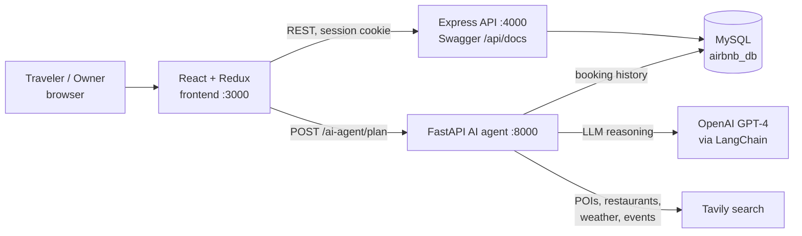

# Airbnb Reservation Platform

> Full-stack Airbnb-style booking platform with separate traveler and owner experiences, a documented REST API, and an AI travel-concierge agent that turns a booking into a day-by-day itinerary.


## Highlights

- **Two-sided marketplace.** Travelers search, favorite, book and cancel stays and see their trip history. Owners list and edit properties, accept or cancel booking requests, and view analytics.
- **REST API with docs.** An Express backend with 6 route modules (traveler, owner, properties, owner properties, bookings, favorites), bcrypt password hashing, cookie-based sessions with separate traveler and owner auth middleware, image uploads (Multer), and Swagger UI at `/api/docs`.
- **AI travel concierge.** A FastAPI + LangChain service (GPT-4) reads the traveler's booking history from MySQL, infers preferences, pulls live local info through Tavily search, and returns a structured plan: daily schedule, activity cards, restaurants filtered by diet, a weather-aware packing list and local tips. It falls back to a default plan if the LLM output fails.
- **Relational data model.** MySQL schema for `travelers`, `owners`, `properties`, `bookings` and `favorites`, with versioned migrations.
- **Frontend state.** React with Redux Toolkit slices per domain (traveler, owner, property, booking), React Router flows for each role, and an accessibility stylesheet.

## Architecture



## Tech stack

| Layer | Tools |
|---|---|
| Frontend | React, Redux Toolkit, React Router, Axios, Bootstrap |
| Backend | Node.js, Express, express-session, bcrypt, Multer, Swagger (swagger-jsdoc + swagger-ui-express) |
| Database | MySQL (schema + migrations in `database/`) |
| AI service | Python, FastAPI, Pydantic, LangChain + OpenAI, Tavily, mysql-connector |
| Tooling | Postman collection (`Airbnb Backend.postman_collection.json`) |

## API overview

| Area | Example endpoints |
|---|---|
| Auth | `POST /api/traveler/signup` · `POST /api/traveler/login` · `POST /api/owner/login` · `GET /api/traveler/check-auth` |
| Properties | `GET /api/properties/search` · `GET /api/properties/:id` · `POST/PUT/DELETE /api/owner/properties/:id` |
| Bookings | `POST /api/bookings/request` · `GET /api/bookings/traveler/history` · `PUT /api/bookings/owner/:id/accept` |
| Favorites | `GET /api/favorites` · `GET /api/favorites/check/:propertyId` · `DELETE /api/favorites/:propertyId` |
| AI agent | `POST /ai-agent/plan` · `GET /health` |

The full interactive spec is at `http://localhost:4000/api/docs` once the backend is running.

## Quickstart

**1. Database**

```bash
mysql -u root -p -e "CREATE DATABASE airbnb_db"
mysql -u root -p airbnb_db < database/schema_v1.1.sql
mysql -u root -p airbnb_db < database/migration_v1.1.sql
```

**2. Backend (port 4000)**

```bash
cd backend
cp .env.example .env        # set DB_PASSWORD and SESSION_SECRET
npm install
npm run dev
```

**3. AI agent (port 8000)**

```bash
cd ai-agent
python -m venv venv && source venv/bin/activate
pip install -r requirements.txt
cp .env.example .env        # set OPENAI_API_KEY, TAVILY_API_KEY, DB_*
python main.py
```

**4. Frontend (port 3000)**

```bash
cd frontend
npm install
REACT_APP_API_URL=http://localhost:4000/api npm start
```

## Project structure

```
frontend/src/
  features/traveler/   features/owner/   features/property/   features/booking/
  services/            # Axios API clients
  app/store.js         # Redux store
backend/
  routes/  controllers/  middleware/  config/  server.js
ai-agent/
  main.py              # FastAPI app
  agent.py             # LangChain planning logic
  tavily_search.py     # live local context
  prompts.py
database/              # schema + migrations
```

## My role

<!-- TODO: your contributions (group project with Jane Heng) -->

## Future work

- Finish the JWT auth migration (currently session-based).
- Stream itinerary generation to the UI.
- Add backend integration tests and CI.
