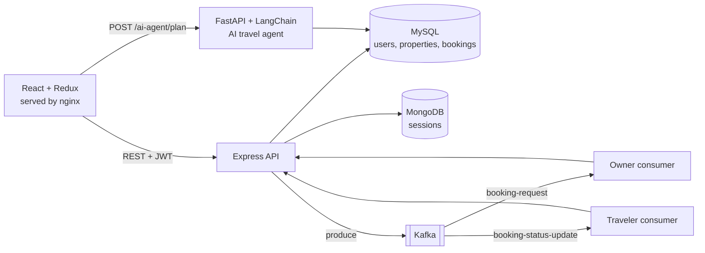

# Airbnb Reservation Platform · v2 Cloud-Native Edition

> The cloud-native edition of the Airbnb-style booking platform, rebuilt for distributed deployment: JWT auth, event-driven booking flow over Kafka, MongoDB-backed sessions, Docker Compose and Kubernetes manifests with autoscaling, and JMeter load-test plans.
>
> 🔀 You are on the **`v2-cloud-native`** branch. The **v1 Full-Stack Edition** (Express + MySQL + AI agent) is on [`main`](https://github.com/IamSavitha/Airbnb_Reservation_Platform/tree/main).


## What changed from v1

| Area | v1 Full-Stack (`main`) | v2 Cloud-Native (`v2-cloud-native`) |
|---|---|---|
| Auth | Cookie sessions in memory | **JWT** (Bearer tokens on all 6 route modules) + sessions persisted in **MongoDB** (`connect-mongo`) |
| Booking flow | Synchronous REST | **Event-driven**: a KafkaJS producer publishes to `booking-request` and `booking-status-update`; owner and traveler consumers react asynchronously |
| Data | MySQL | **MySQL** for application data + **MongoDB** for sessions |
| Deployment | Run locally | **Docker Compose** (8 services) and **Kubernetes** (namespace, ConfigMap, Secret, 8 deployments, 4 PVCs, HPA) |
| Scaling | None | **Horizontal Pod Autoscaler**: backend 1–5 replicas, frontend 2–5 |
| Performance | None | **JMeter** plans for auth, property search and booking, scripted at 100–500 concurrent users |

## Architecture



Everything above also runs in the Kubernetes namespace `airbnb` (`k8s/`).

## Booking event flow

1. A traveler requests a booking. The API writes it to MySQL and publishes it to `booking-request`.
2. The **owner consumer** receives the request, and the owner sees it in their dashboard.
3. The owner accepts or cancels. The API publishes to `booking-status-update`.
4. The **traveler consumer** receives the status change, and the traveler's bookings update.

Kafka UI (`:8080`) shows topics and messages live.

## Tech stack

| Layer | Tools |
|---|---|
| Frontend | React, Redux Toolkit (traveler / owner / property / booking slices, async thunks), Axios with a JWT interceptor, nginx |
| Backend | Node.js, Express, `jsonwebtoken`, bcrypt, `connect-mongo`, KafkaJS, Multer, Swagger |
| AI service | Python, FastAPI, LangChain + OpenAI, Tavily |
| Data | MySQL 8, MongoDB 7 |
| Messaging | Apache Kafka + Zookeeper, Kafka UI |
| Infra | Docker (separate Dockerfiles per service), Docker Compose, Kubernetes (HPA, PVC, ConfigMap, Secret) |
| Testing | Apache JMeter (3 test plans + runner script), Postman collection |

## Quickstart

**Docker Compose**

```bash
git clone -b v2-cloud-native https://github.com/IamSavitha/Airbnb_Reservation_Platform.git
cd Airbnb_Reservation_Platform
cp backend/.env.example backend/.env          # set DB and session values
docker-compose up -d
docker-compose ps
```

| Service | URL |
|---|---|
| Frontend | http://localhost:3000 |
| Backend API | http://localhost:4000 (Swagger at `/api/docs`) |
| AI agent | http://localhost:8000 |
| Kafka UI | http://localhost:8080 |

> The frontend API URLs in `frontend/src/services/api.js` and `frontend/src/components/AgentButton.js` point to the team's AWS deployment. For a local run, change them to `http://localhost:4000/api` and `http://localhost:8000`.

**Kubernetes**

```bash
# edit k8s/02-secrets.yaml first (placeholder values)
kubectl apply -f k8s/
kubectl get pods -n airbnb -w
kubectl get hpa -n airbnb
```

**Load tests**

```bash
cd jmeter && ./run-all-tests.sh      # 100 → 500 concurrent users, HTML reports
```

## Results

<!-- TODO: metric — add JMeter throughput / latency / error rate per user level from the HTML reports -->

## Project structure

```
backend/      Express API, Kafka producer (config/kafka.js) and consumers (kafka/), JWT utils
frontend/     React + Redux app, nginx config, Dockerfile
ai-agent/     FastAPI + LangChain travel planner, Dockerfile
k8s/          00-namespace … 07-mongodb-deployment (HPA in 05/06)
jmeter/       test plans + runner
database/     schemas + migrations
docs/         architecture report, setup guides (Docker/K8s, Kafka, JWT, JMeter)
```

Detailed guides: [Overview](docs/OVERVIEW.md) · [Docker & Kubernetes](docs/DOCKER_KUBERNETES_SETUP.md) · [Kafka](docs/KAFKA_SETUP.md) · [JWT](docs/JWT_IMPLEMENTATION.md) · [JMeter](docs/JMETER_SETUP.md) · [Architecture report](docs/ARCHITECTURE_REPORT.md)

## My role

<!-- TODO: your contributions (team project with Jane Heng) -->
